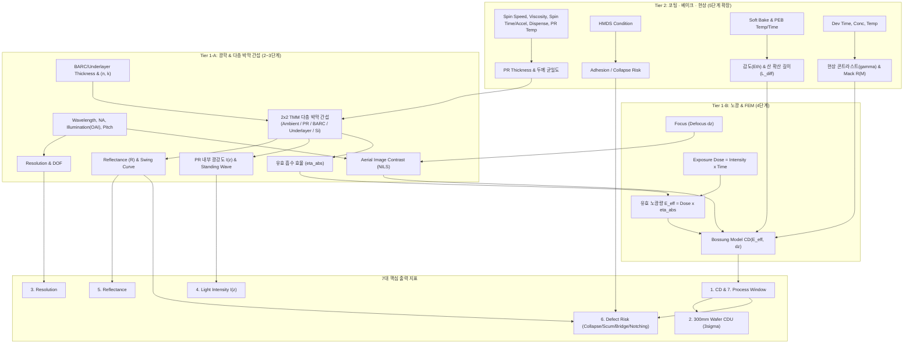

# 1단계: 포토공정 물리 명세서 및 변수 인과관계 설계

- 프로젝트: [[03.Project/photo-litho-simulator/README|photo-litho-simulator]]
- 한계 및 실제 공정 비교: [[03.Project/photo-litho-simulator/docs/02_limitations|02_limitations]]
- 내부 참고 강의자료:
  - [[02.Sources/강의자료/집적회로공정/MD/Week7_Fabrication of IC_Photolitho1|Week 7 Photolithography 1]]
  - [[02.Sources/강의자료/집적회로공정/MD/Week9_Fabrication of IC_Photolitho 2|Week 9 Photolithography 2]]
- 학술·표준 문헌 출처:
  - Chris A. Mack, *Fundamental Principles of Optical Lithography: The Science of Microfabrication* (Wiley)
  - Harry J. Levinson, *Principles of Lithography* (SPIE, 1st–4th ed.)
  - R. Dill et al. (IBM, 1970s) — Photoresist exposure kinetics ($A, B, C$ model)
  - J. W. Bossung (1977) — Focus–Exposure Matrix / Bossung plot
  - A. G. Emslie, F. T. Bonner, L. G. Peck (1958) & D. Meyerhofer (1978) — Spin coating hydrodynamics
  - RefractiveIndex.INFO (`https://refractiveindex.info/`) — c-Si DUV optical constants ($n, k$)

---

## 1. 시뮬레이션 기준선 (Baseline Definition)

| 항목 | 확정 기준 | 설계 근거 |
| :--- | :--- | :--- |
| **PR 극성 (Tone)** | **Positive PR** (노광부 현상 제거) | 반도체 미세 패터닝 주력([[02.Sources/강의자료/집적회로공정/MD/Week7_Fabrication of IC_Photolitho1|Week 7 Slide 6, 10]]). Dose $\uparrow \Rightarrow$ Line CD $\downarrow$, Space CD $\uparrow$로 부호 일관성 확보 |
| **기준 패턴 (Pattern)** | **1D Line/Space** (`Dense 1:1` / `Isolated Line` 전환) | Dense vs Iso에 따른 Bossung 곡선 형태(Smile/Frown), Iso-focal bias, 조명계(OAI) 효과 비교 가능 |
| **노광 세대 (Nodes)** | 본 시뮬레이터: **DUV 3종** (`KrF 248nm`, `ArF Dry 193nm`, `ArFi 193nm`) 비교 전용: **EUV `13.5nm`** (2단계 해상도·DOF 비교 차트 한정) | EUV는 반사광학계(Multilayer mirror)·확률적 샷 노이즈 영역이라 투과형 TMM/BARC 모델과 물리가 다름 |
| **하부막 프리셋 (Underlayer)** | `Bare Si`, `SiO₂`, `Poly-Si`, `Al (Metal)` 4종 | [[02.Sources/강의자료/집적회로공정/MD/Week9_Fabrication of IC_Photolitho 2|Week 9 Slide 15, 20]]의 Oxide/Poly-Si/Al 반사율·노광에너지 차이 및 BARC 효과를 극명하게 검증 |
| **CDU 시각화** | **300mm 웨이퍼 2D CDU 맵** + Mean / $3\sigma$ 통계 | 중심–가장자리 코팅 두께 프로파일, PEB 온도 구배, 샷별 Focus/Dose 편차를 시각적으로 직관화 |

---

## 2. 물리 인과관계 그래프 (Causal DAG — Optics ↔ FEM 결합)

3단계(광학 TMM)와 4단계(FEM)를 분리하지 않고, **TMM으로 계산한 유효 흡수 광량($\eta_{abs}$)과 반사율($R$)이 FEM의 유효 Dose 축($E_{eff}$)과 결함 지표로 직접 전파**되도록 결합한다.

---

## 3. 전체 포토공정 변수 사전 (30개 변수 — Tier 1 / Tier 2)

### A. 광학 및 노광 변수 (8개 + Pattern Pitch)

| 변수명 | 기호 | 단위 | 현실적 범위 | 기본값 (ArFi) | Tier | 물리적 의미 및 영향 |
| :--- | :---: | :---: | :---: | :---: | :---: | :--- |
| Wavelength | $\lambda$ | nm | 193 ~ 365 (비교: 13.5) | 193 | **Tier 1** | 광원 파장. 짧을수록 회절 한계 감소(해상도 향상) |
| Numerical Aperture | $NA$ | - | 0.50 ~ 1.35 (비교 EUV: 0.33~0.55) | 1.35 | **Tier 1** | 렌즈 집광 능력($n\sin\theta$). $NA\uparrow \Rightarrow CD\downarrow, DOF\downarrow\downarrow$ |
| Process Factor | $k_1$ | - | 0.25 ~ 0.60 | 0.32 | **Tier 1** | 공정/RET 난이도 계수. 물리적 단일 패터닝 하한 $\approx 0.25$ |
| Focus (Defocus) | $\Delta z$ | nm | -250 ~ +250 | 0 | **Tier 1** | 최적 초점면 대비 이탈량. $|\Delta z|\uparrow \Rightarrow$ Aerial Image 콘트라스트 저하 |
| Exposure Dose | $E$ | mJ/cm² | 5.0 ~ 60.0 | 28.0 | **Tier 1** | 단위 면적당 노광 에너지($I_0 \times t$). Positive PR에서 $E\uparrow \Rightarrow$ Line CD $\downarrow$ |
| Light Intensity | $I_0$ | mW/cm² | 10.0 ~ 500.0 | 280.0 | **Tier 1** | 웨이퍼 표면 입사 광도. $E = I_0 \cdot t$ 관계로 노광 시간과 결합 |
| Exposure Time | $t_{exp}$ | s | 0.01 ~ 5.0 | 0.10 | **Tier 1** | 노광 시간. 일정 Dose 유지를 위해 광도 변화 시 자동 보정([[02.Sources/강의자료/집적회로공정/MD/Week9_Fabrication of IC_Photolitho 2|Week 9 Slide 14]]) |
| Illumination Condition | OAI / $\sigma$ | mode | Conv / Annular / Dipole / Quad | Annular | **Tier 1** | 조명계 형태. Off-Axis Illumination(OAI)은 유효 $k_1\downarrow$, Dense DOF $\uparrow$ |
| Pattern Pitch / Duty | $P$ | nm | Dense 1:1 / Iso (Duty 0.2~0.5) | Dense (90nm) | **Tier 1** | 마스크 패턴 밀도. Bossung 곡선의 Iso-focal bias 및 Smile/Frown 결정 |

### B. PR 코팅 변수 (8개)

| 변수명 | 기호 | 단위 | 현실적 범위 | 기본값 | Tier | 물리적 의미 및 영향 |
| :--- | :---: | :---: | :---: | :---: | :---: | :--- |
| PR Thickness | $d_{PR}$ | nm | 60 ~ 1200 | 120 | **Tier 1** | PR 막 두께. Swing Curve 위상, 흡수량, Aspect Ratio(패턴 붕괴) 직접 결정 |
| PR Viscosity | $\eta$ | cP | 1.0 ~ 50.0 | 3.0 | **Tier 2** | PR 점도. Meyerhofer 식에 따라 $\eta\uparrow \Rightarrow d_{PR}\uparrow$([[02.Sources/강의자료/집적회로공정/MD/Week7_Fabrication of IC_Photolitho1|Week 7 Slide 17]]) |
| Spin Speed | $\omega$ | RPM | 1000 ~ 7000 | 3000 | **Tier 2** | 최종 회전 속도. $d_{PR} \propto \omega^{-1/2}$로 막 두께 정밀 제어 |
| Spin Acceleration | $\alpha_{spin}$ | RPM/s | 1000 ~ 20000 | 10000 | **Tier 2** | 가속도. 초기 확산 균일도 및 Edge Bead 크기에 영향 |
| Spin Time | $t_{spin}$ | s | 10 ~ 90 | 45 | **Tier 2** | 용매 증발 및 막 평탄화 시간(최소 10초 이상, 통상 30~60초) |
| Dispense Volume | $V_{disp}$ | mL | 0.5 ~ 5.0 | 2.0 | **Tier 2** | 토출량. 부족 시 코팅 불균일/미도포 결함([[02.Sources/강의자료/집적회로공정/MD/Week9_Fabrication of IC_Photolitho 2|Week 9 Slide 16]]) |
| PR Temperature | $T_{PR}$ | °C | 18.0 ~ 26.0 | 22.0 | **Tier 2** | PR 액온. 온도 상승 시 점도 감소 $\Rightarrow$ 목표 두께 변동 |
| HMDS Condition | HMDS | score/flag | None / Spin / Vapor | Vapor | **Tier 2** | 소수성 표면 처리. 미처리 시 접착력 저하 $\Rightarrow$ Pattern Collapse·박리 리스크 급증 |

### C. 베이크 및 현상 변수 (8개)

| 변수명 | 기호 | 단위 | 현실적 범위 | 기본값 | Tier | 물리적 의미 및 영향 |
| :--- | :---: | :---: | :---: | :---: | :---: | :--- |
| Soft Bake Temp | $T_{SB}$ | °C | 80 ~ 130 | 105 | **Tier 2** | 잔류 용매 증발 및 밀착력 확보. 과도 시 감도 저하·Scum 유발([[02.Sources/강의자료/집적회로공정/MD/Week9_Fabrication of IC_Photolitho 2|Week 9 Slide 17]]) |
| Soft Bake Time | $t_{SB}$ | s | 30 ~ 180 | 60 | **Tier 2** | Soft Bake 유지 시간. 용매 잔류량과 현상 속도(dark loss) 조절 |
| PEB Temp | $T_{PEB}$ | °C | 90 ~ 140 | 115 | **Tier 2** | CAR 산 확산 및 Standing Wave 완화([[02.Sources/강의자료/집적회로공정/MD/Week9_Fabrication of IC_Photolitho 2|Week 9 Slide 19]]). CD 온도 민감도(nm/°C)의 핵심 원인 |
| PEB Time | $t_{PEB}$ | s | 30 ~ 120 | 60 | **Tier 2** | 산 확산 거리 $L_{diff} \propto \sqrt{D(T_{PEB})\cdot t_{PEB}}$ 결정 |
| Hard Bake Temp | $T_{HB}$ | °C | 110 ~ 150 | 125 | **Tier 2** | 현상 후 내식각성 강화. 과도 시 PR Thermal Flow로 프로파일 뭉개짐([[02.Sources/강의자료/집적회로공정/MD/Week7_Fabrication of IC_Photolitho1|Week 7 Slide 22]]) |
| Development Time | $t_{dev}$ | s | 15 ~ 120 | 60 | **Tier 2** | 현상 시간. 부족 시 Scum, 과도 시 CD 축소(Dark Loss) |
| Developer Conc. | $C_{dev}$ | wt% (TMAH) | 2.0 ~ 2.6 | 2.38 | **Tier 2** | 현상액 농도(표준 2.38 wt% TMAH). 용해 속도 $R_{max}$와 콘트라스트 $\gamma$ 제어 |
| Developer Temp | $T_{dev}$ | °C | 18.0 ~ 26.0 | 23.0 | **Tier 2** | 현상액 온도. 용해 반응 속도 및 CDU에 영향 |

### D. 광학적 물성 및 하부막 변수 (7개)

| 변수명 | 기호 | 단위 | 현실적 범위 | 기본값 (193nm) | Tier | 물리적 의미 및 영향 |
| :--- | :---: | :---: | :---: | :---: | :---: | :--- |
| Refractive Index | $n$ | - | 1.0 ~ 4.5 | PR 1.70 / BARC 1.75 | **Tier 1** | 매질 굴절률. 계면 반사 및 박막 내부 광경로($n\cdot d$)·정상파 주기($\lambda/2n$) 결정 |
| Extinction Coeff. | $k$ | - | 0.0 ~ 4.5 | PR 0.02 / BARC 0.45 | **Tier 1** | 복소 굴절률 $\tilde{n} = n + ik$의 허수부. 매질 내 감쇠(흡수) 결정 |
| Absorption Coeff. | $\alpha$ | $\mu\text{m}^{-1}$ | 유도값 | $4\pi k / \lambda$ | **Tier 1** | Beer-Lambert 감쇠 계수. PR 깊이별 광강도 감쇠율 |
| Reflectance | $R$ | % | 0 ~ 100 (출력/제어) | TMM 계산 | **Tier 1** | 스택 총 반사율. 하부막 반사가 크면 Standing Wave·Swing 진폭 증가 |
| Transmittance | $T$ | % | 0 ~ 100 (출력) | TMM 계산 | **Tier 1** | 스택 투과율. 에너지 보존 $R + T + A = 1$ 검증 기준 |
| BARC Thickness | $d_{BARC}$ | nm | 0 ~ 150 | 40 (Off=0) | **Tier 1** | 하부 반사방지막 두께. 최적 두께($\approx \lambda / 4n_{BARC}$)에서 상쇄간섭+흡수로 반사 극소화 |
| Underlayer Thickness | $d_{UL}$ | nm | 0 ~ 500 | 100 | **Tier 1** | 하부막(`SiO₂`, `Poly-Si`, `Al`) 두께. 다층 간섭 위상 변화 유발 |

---

## 4. 핵심 지배 방정식 (Governing Equations)

### 4.1 해상도 및 초점심도 (2단계)
- **Rayleigh Resolution**:
  $$CD_{min} = k_1 \frac{\lambda}{NA}$$
- **Depth of Focus (Paraxial & High-NA Immersion)**:
  - Dry 근사: $DOF = k_2 \frac{\lambda}{NA^2}$
  - High-NA / Immersion 보정(Mack):
    $$DOF = \frac{k_2}{2} \frac{\lambda}{n_{fluid} - \sqrt{n_{fluid}^2 - NA^2}}$$
  *(단, Dry는 $n_{fluid}=1.0$, ArF Immersion 물은 $n_{fluid}=1.44$; $NA \ll n_{fluid}$ 극한에서 $k_2 n_{fluid}\lambda / NA^2$로 수렴)*
- **Illumination (OAI) 보정**:
  - Conventional 대비 Annular / Dipole / Quadrupole 조명 적용 시 유효 $k_1$ 감소(해상력 개선) 및 Dense 패턴의 $k_2$ 증가(DOF 확장)를 프리셋 계수로 모델링.

### 4.2 다층 박막 광학 TMM & PR 내부 광강도 (3단계)
다층 스택 $\text{Ambient}(0) / \text{PR}(1) / \text{BARC}(2) / \text{Underlayer}(3) / \text{Si Substrate}(4)$에서 각 층 $j$는 복소 굴절률 $\tilde{n}_j = n_j + i k_j$, 두께 $d_j$를 가진다.

- **Fresnel 반사/투과 계수** (수직 입사 기준, 경사 입사 시 s/p-편광 평균으로 확장 가능):
  $$r_{j,j+1} = \frac{\tilde{n}_j - \tilde{n}_{j+1}}{\tilde{n}_j + \tilde{n}_{j+1}}, \quad t_{j,j+1} = \frac{2\tilde{n}_j}{\tilde{n}_j + \tilde{n}_{j+1}}$$
- **2×2 Transfer Matrix Method (TMM)**:
  - 계면 행렬 $I_{j,j+1}$과 전파 행렬 $L_j(\delta_j)$ ($\delta_j = \frac{2\pi}{\lambda}\tilde{n}_j d_j \cos\theta_j$)의 곱:
    $$M = I_{0,1} L_1 I_{1,2} L_2 \cdots I_{N-1,N}$$
  - 총 반사율 $R = |M_{10}/M_{00}|^2$, 총 투과율 $T = \frac{\text{Re}(\tilde{n}_N\cos\theta_N)}{\text{Re}(\tilde{n}_0\cos\theta_0)} |1/M_{00}|^2$, 총 흡수율 $A = 1 - R - T$.
- **PR 내부 깊이별 광강도 분포 $I(z)$**:
  - TMM으로 PR 내부 순방향($E^+$) 및 역방향($E^-$) 복소 전계를 구해 $I(z) = |E^+(z) + E^-(z)|^2$ 계산.
  - Beer-Lambert 감쇠($\alpha = 4\pi k_{PR}/\lambda$)와 정상파 주기($\Lambda_{SW} = \frac{\lambda}{2 n_{PR}}$)가 자연스럽게 재현됨.
- **유효 흡수 효율 ($\eta_{abs}$) — 4단계 결합 변수**:
  $$\eta_{abs} = \frac{\bar{I}_{PR}}{I_{ref}}$$
  *(PR 두께/BARC/하부막에 따른 평균 내부 광강도 비율이 실제 PR이 받는 유효 Dose $E_{eff} = E \cdot \eta_{abs}$를 이동시킴)*

### 4.3 Optics-Coupled FEM & Bossung 모델 (4단계)
- **Aerial Image & Defocus 콘트라스트 저하**:
  - 패턴 Pitch $P$와 조명계($\sigma$/OAI)에 따른 기본 Aerial Image 콘트라스트 $C_0$, Defocus $\Delta z$에 따른 광학 전달 저하(Gaussian/Sinc 근사):
    $$C(\Delta z) = C_0 \cdot \exp\left(-\frac{1}{2}\left(\frac{\Delta z}{w_{DOF}}\right)^2\right)$$
- **Bossung Curve 물리 근사 ($CD$ vs Focus & Dose)**:
  - Positive PR 기준, 유효 노광량 $E_{eff} = E \cdot \eta_{abs}$와 Iso-focal Dose $E_{iso}$의 편차에 따라 Defocus 곡률 부호가 반전(Smile vs Frown)되는 대표 Bossung 거동 모델링:
    $$CD(E_{eff}, \Delta z) = CD_{target} - S_E \cdot \ln\left(\frac{E_{eff}}{E_{nom}}\right) + \left[\kappa_0 + \kappa_E \cdot \ln\left(\frac{E_{eff}}{E_{iso}}\right)\right] (\Delta z - z_0)^2 + \Delta CD_{bias}$$
  - 여기서 $S_E \propto 1/\text{NILS}$ (Dose 민감도), $\kappa_0$는 Dense/Iso 패턴의 고유 곡률, $\kappa_E$는 Focus–Dose 상호작용 항(Iso-focal 전환), $z_0$는 Best Focus, $\Delta CD_{bias}$는 PEB 확산($L_{diff}$) 및 현상 시간 보정항.
- **Process Window (PW)**:
  - 허용 오차: $|CD(E, \Delta z) - CD_{target}| \le 0.10 \cdot CD_{target}$ ($\pm 10\%$ CD 스펙)
  - 평가지표: 허용 영역(Overlapping Corridor) 내부에 내접하는 최대 직사각형의 **Exposure Latitude (EL%)** 와 **Depth of Focus (DOF, nm)** 산출.

### 4.4 Tier 2 하위 공정 보정식 (5단계)
- **Spin Coating (Meyerhofer 스케일링)**:
  $$d_{PR} = K_{spin} \cdot \eta^{1/3} \cdot \omega^{-1/2} \cdot f(T_{PR}, t_{spin})$$
- **PEB 산 확산 (Arrhenius)**:
  $$L_{diff} = \sqrt{2 D_0 \exp\left(-\frac{E_a}{k_B T_{PEB}}\right) t_{PEB}}$$
- **Mack 현상 속도 모델**:
  $$R(M) = R_{min} + (R_{max} - R_{min}) \frac{(a + 1)(1 - M)^n}{a + (1 - M)^n}$$
- **300mm 웨이퍼 CDU 맵**:
  - 웨이퍼 좌표 $(x, y)$ ($r \le 150\text{ mm}$)에서 반경 방향 PR 두께 구배 $\Delta d_{PR}(r)$, 핫플레이트 PEB 온도 구배 $\Delta T_{PEB}(r, \theta)$, 노광 샷(Field)별 Focus/Dose 랜덤 산포를 물리 엔진에 통과시켜 웨이퍼 맵 CD 분포 및 $3\sigma$ 산출.

---

## 5. 7대 출력 결과 및 정량 결함(Defect) 판정 기준

| # | 출력 결과 | 산출 방식 / 단위 | 정상·판정 기준 |
| :-: | :--- | :--- | :--- |
| 1 | **CD** | Bossung 모델 출력 (nm) | $CD_{target} \pm 10\%$ |
| 2 | **CD Uniformity** | 300mm 웨이퍼 맵 $3\sigma$ (nm, %) | $3\sigma \le 3\%\text{ of }CD_{target}$ 목표 |
| 3 | **Resolution** | Rayleigh $CD_{min}$ 및 DOF (nm) | $CD_{target} \ge CD_{min}$ |
| 4 | **Light Intensity $I(z)$** | TMM PR 깊이 프로파일 (a.u.) | Standing Wave Ratio $SWR = I_{max}/I_{min}$ |
| 5 | **Reflectance** | TMM 총 반사율 $R$ (%) | BARC 적용 시 기판 반사 $< 2\%$ 목표 |
| 6 | **Defect Risk** | 4종 정량 위험도 지수 (0~100 / Flag) | 아래 정량 규칙 적용 |
| 7 | **Process Window** | $\pm 10\%$ CD 영역 내 최대 내접 (DOF @ EL%) | 목표 EL $\ge 5\%$, DOF $\ge 100\text{ nm}$ (노드별 조정) |

### 정량 결함(Defect) 규칙
1. **Pattern Collapse (패턴 붕괴)**: Aspect Ratio $AR = d_{PR} / CD > 3.0$ (HMDS 미처리 시 임계 $2.2$로 강화)
2. **Scumming (잔막/미현상)**: 저노광 또는 과도 Soft Bake로 유효 Dose $E_{eff} < 0.75 E_{nom}$ 또는 $CD > 1.15 \cdot CD_{target}$
3. **Bridging / Pinching (단락·단선)**: 과노광/과초점 이탈로 Line CD $< 0.75 \cdot CD_{target}$ 또는 Aerial Image 콘트라스트 $C(\Delta z) < 0.25$
4. **Reflective Notching (반사 노칭)**: 하부막 반사율 $R > 15\%$ 또는 Standing Wave Ratio $SWR > 2.0$

---

## 6. 물리 정합성 검증 계약 (Unit Test Sanity Checks)

2~4단계 코드 구현 시 아래 수학적 불변 조건을 `pytest` 단위 테스트로 강제한다.

1. **Zero-Reflection Test**: 모든 층의 굴절률이 같고($n_0 = n_1 = \dots = n_N$) $k=0$이면 반사율 $R = 0$, 투과율 $T = 1$.
2. **Energy Conservation**: 임의의 무손실/흡수 스택에서 $0 \le R, T, A \le 1$ 및 $R + T + A = 1$ (허용오차 $10^{-10}$).
3. **Standing Wave Periodicity**: $k_{PR} \approx 0$일 때 $I(z)$ 인접 극댓값 간격은 $\frac{\lambda}{2 n_{PR}}$와 일치.
4. **BARC Effectiveness**: 고반사 하부막(`Al` 또는 `Bare Si`)에서 최적 두께 BARC 삽입 시 반사율과 Swing Curve 진폭이 BARC 미적용 대비 현저히 감소.
5. **Positive PR Monotonicity**: 고정 Focus에서 Dose $\uparrow \Rightarrow$ Line CD 단조 감소.
6. **Defocus Symmetry & Iso-focal**: Best Focus($\Delta z = z_0$)에서 $\partial CD/\partial \Delta z = 0$, $E_{eff} = E_{iso}$ 근처에서 Focus 민감도 극소화.
7. **Resolution Scaling**: $\lambda\downarrow$ 또는 $NA\uparrow \Rightarrow CD_{min}\downarrow$, $NA\uparrow \Rightarrow DOF\downarrow$.

---

## 7. 6단계 ML 전략 (순환논증 방지 설계)

물리 수식으로 생성한 무노이즈 데이터를 ML로 단순 피팅하면 $R^2 \approx 0.99$의 자명한 결과만 나온다. 이를 피하고 포트폴리오 설득력을 높이기 위해 6단계는 **3가지 명확한 목적**으로 설계한다.

1. **고속 Surrogate 기반 다변수 역최적화**: TMM + 2D FEM 그리드 탐색 비용을 줄여, 목표 CD를 맞추면서 Process Window(DOF × EL)를 극대화하는 최적 `(Dose, Focus, d_PR, d_BARC, T_PEB)` 조합 탐색.
2. **가상 Fab 노이즈 환경 Root-Cause 진단 (SHAP)**: 측정 오차 및 미관측 공정 드리프트(PEB 온도 흔들림, 두께 산포)가 포함된 가상 양산 데이터에서 XGBoost + SHAP으로 CD 산포 주원인 변수를 정량 분해.
3. **외삽 한계(Extrapolation Failure) 입증 실험**: `193nm` 영역에서만 학습한 트리 모델(RF/XGBoost)에 `248nm` 데이터를 입력해 예측이 붕괴하는 현상을 물리 모델과 대조 시각화 → **"ML은 데이터 보간·최적화 도구이지 물리 인과를 증명·대체하지 않는다"**는 엔지니어링 결론 도출.
